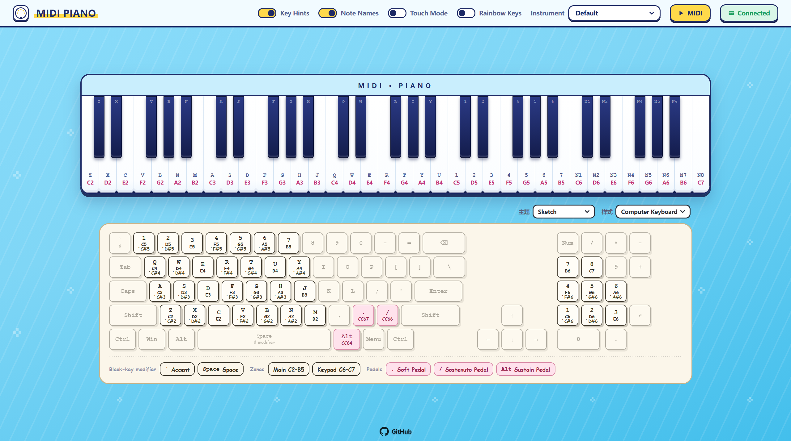
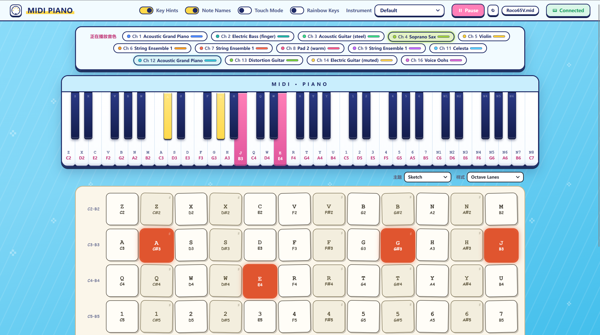
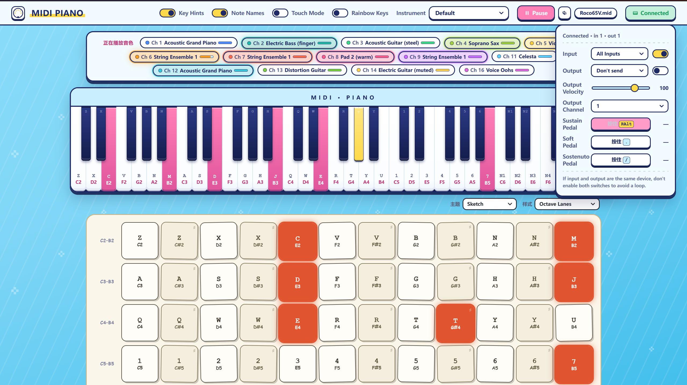

# 🎹 MIDIPiano

MIDIPiano is a **pure browser-based** web piano / MIDI player. No plugins required — just open the page to:
play with your computer keyboard or on-screen keys, switch between 128 GM instruments, upload and play MIDI files,
and connect a real MIDI keyboard.

## ✨ Features
- 🎹 **Three ways to play**: computer keyboard, on-screen virtual keys, or an external MIDI device.
- 🎨 **128 GM instruments**: piano, guitar, strings, brass, synths, etc. — lazily loaded on demand for fast first response.
- 📁 **MIDI file playback**: upload `.mid` / `.midi`; multi-channel instruments are auto-detected with a loading progress bar.
- 🔌 **Real MIDI devices**: Web MIDI support; instrument is auto-selected per channel program, prefetched on Program Change.
- 📱 **Responsive UI** with a touch mode.
- 🐳 **One-command deploy** via Dockerfile and docker-compose.
- 🌐 **UI language switch**: click the "MIDI PIANO" logo icon at the top-left to toggle Chinese / English.

## 🚀 Quick Start

### Option A: Docker (pull the published image)
```bash
# use docker compose (auto-pulls the image)
docker compose up -d

# or run directly with docker run
docker run -d -p 9177:9177 --name midipiano roco65v/midipiano:latest
```
Open: <http://localhost:9177>

> Default port is `9177`; change it in `main.go` or `docker-compose.yml`.

### Option B: Windows executable
Download the prebuilt Windows program `midipiano.exe` and double-click to run.
```text
1. Download midipiano.exe to your local PC
2. Double-click midipiano.exe (a console window shows the listen address)
3. Open http://localhost:9177 in your browser
```

## 📖 User Guide

> 💡 **Language**: click the **MIDI PIANO logo icon** at the top-left to switch between Chinese / English. The choice is remembered in your browser.

### 1. Play with your computer keyboard
Each on-screen key shows its mapped letter. Just press the keys to make sound:
- A letter row (e.g. `A S D F…`) maps to white keys; the parallel row maps to black keys.
- Press `` ` `` (backtick) or `Space` to toggle "black-key mode" for sharps/flats.
- You can also click/tap the on-screen keys with mouse or touch.

### 2. Switch instruments
Use the "Instrument" dropdown at the top (piano, violin, synth lead, …).
The first use of an instrument loads it on demand (only the samples actually needed), then caches it.

### 3. Play a MIDI file
Click the ▶ button at the top and choose a local `.mid` / `.midi` file.
- Multi-channel / multi-instrument files load each instrument separately, with a "Loading samples …" progress bar.
- Playback starts automatically once loaded; you can stop or re-select at any time.

### 4. Connect a MIDI device (hardware keyboard)
Click the "MIDI device" button, grant permission, and pick an input port.
- The instrument is auto-selected per channel program number as you play.
- A Program Change message prefetches the new instrument ahead of time.

> ⚠️ **Important**: Web MIDI is only available in a **secure context**.
> - Local `http://localhost:9177` ✅ works
> - LAN `http://your-IP:9177` ❌ blocked (browser disables the API)
> - For MIDI on other LAN devices, serve over **HTTPS** (self-signed cert or reverse proxy).

### 5. Pedals & MIDI Control (CC)
Three sustain-style pedals and common Control Change (CC) messages are supported. Trigger them by clicking the pedal blocks below the on-screen keys or by computer keys; when a MIDI device is connected they are forwarded, and MIDI file playback follows the pedal events recorded in the file.

| Control | CC | Key | Description |
| --- | --- | --- | --- |
| Sustain | 64 | Right Alt | Notes keep sounding after release until the pedal is released |
| Sostenuto | 66 | `/` | Holds only the notes currently held; later notes are unaffected |
| Soft | 67 | `.` | Reduces the velocity (loudness) of notes under the pedal |

Other CC / velocity controls:
- **Velocity**: the "MIDI device" panel has a velocity slider (default 100, range 1–127); the velocity of notes from a real MIDI device is also used. Velocity determines loudness and sample layering.
- **CC7 Channel Volume** and **CC11 Expression**: adjust that channel's overall volume in real time (final volume = CC7 × CC11). Applies to both MIDI file playback and device input, and is shown on the voice console level meter.
- With MIDI output enabled, the pedals and CC above are sent to the external MIDI device.

## 🖼️ Screenshots
Drop the **English UI** screenshots into the `docs/en/` folder (Chinese UI screenshots go in `docs/zh/` for the Chinese README); see `docs/PUT_SCREENSHOTS_HERE.txt` for names.





## 🛠️ Deployment
This project is distributed in two ways — no need to build from source:
- **Docker image**: `roco65v/midipiano:latest` (published; pull and run, see Option A above).
- **Windows executable**: `midipiano.exe` (published; double-click to run, see Option B above).
- **Reverse proxy (HTTPS)**: put nginx / caddy in front with TLS so LAN devices can use MIDI.

## ❓ FAQ
- **MIDI device shows "unavailable"?** Usually because you accessed via a LAN IP over HTTP — the browser blocks Web MIDI. Use `localhost` or HTTPS.
- **Instrument switch stutters?** Instruments load lazily; the first load downloads samples, then they are cached. Slower first response on a server is expected.
- **No sound for a long time after playing MIDI?** Multi-instrument samples load in the background; no sound plays until loading finishes — watch the progress bar.

---
[🇨🇳 中文 README](README.zh.md)
