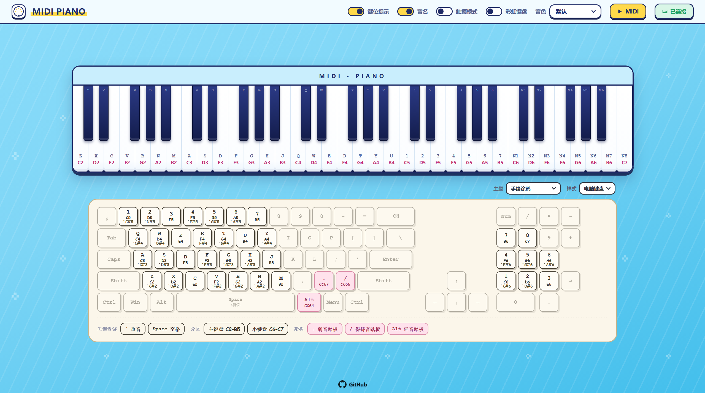
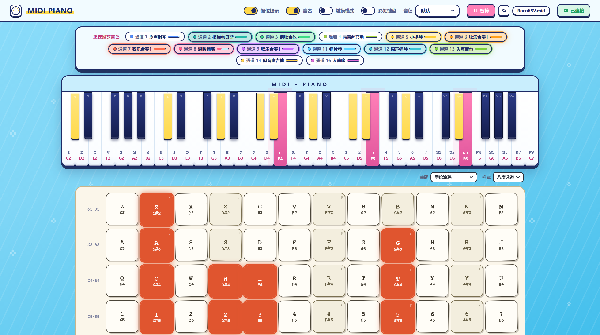
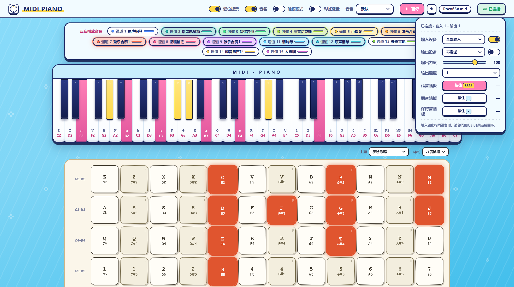

# 🎹 MIDIPiano

MIDIPiano 是一个**纯浏览器**的网页钢琴 / MIDI 演奏器。无需安装任何插件，打开网页即可：
用电脑键盘或屏幕琴键演奏、切换 128 种 GM 音色、上传并播放 MIDI 文件、连接真实的 MIDI 键盘设备。

## ✨ 功能特性
- 🎹 **三种演奏方式**：电脑键盘、屏幕虚拟琴键、外接 MIDI 设备。
- 🎨 **128 种 GM 音色**：钢琴、吉他、弦乐、管乐、合成器等，按需懒加载，首响快。
- 📁 **MIDI 文件播放**：上传 `.mid` / `.midi`，自动识别多通道音色，带加载进度提示。
- 🔌 **真实 MIDI 设备**：支持 Web MIDI，按通道 program 自动选音色；Program Change 时预取音色。
- 📱 **响应式界面**：支持触屏模式。
- 🐳 **一键部署**：提供 Dockerfile 与 docker-compose。
- 🌐 **界面中英文切换**：点击左上角“MIDI PIANO”图标即可一键切换中文 / English。

## 🚀 快速开始

### 方式一：Docker（拉取已发布镜像）
```bash
# 使用 docker compose（自动拉取镜像）
docker compose up -d

# 或直接使用 docker run 拉取并运行
docker run -d -p 9177:9177 --name midipiano roco65v/midipiano:latest
```
访问：<http://localhost:9177>

> 端口默认 `9177`，可在 `main.go` 或 `docker-compose.yml` 中修改。

### 方式二：Windows 可执行文件
直接下载已打包的 Windows 程序 `midipiano.exe`，双击即可运行。
```text
1. 将 midipiano.exe 下载到本地
2. 双击 midipiano.exe（会弹出命令行窗口并显示监听地址）
3. 浏览器打开 http://localhost:9177
```

## 📖 操作指南

> 💡 **语言切换**：点击左上角的 **MIDI PIANO 图标（logo）** 即可在「中文 / English」之间切换，选择会记在浏览器本地。

### 1. 用电脑键盘演奏
页面上的虚拟琴键会标注对应的字母键。直接敲击键盘即可发声：
- 一行字母（如 `A S D F…`）对应白键，配合黑键行对应黑键。
- 按 `` ` ``（反引号）或 `空格` 可切换“黑键模式”，便于演奏升/降音。
- 也可直接用鼠标 / 触屏点击屏幕琴键。

### 2. 切换音色
在顶部“乐器”下拉框中选择音色（如 钢琴、小提琴、合成主音等）。
首次使用该音色时会按需加载（仅加载实际需要的采样），之后会缓存。

### 3. 播放 MIDI 文件
点击顶部的 ▶ 按钮，选择本地 `.mid` / `.midi` 文件。
- 多通道、多音色会自动分别加载，并显示“正在加载音色采样 …”进度条。
- 加载完成后自动开始播放，可随时停止 / 重新选择文件。

### 4. 连接 MIDI 设备（硬件键盘）
点击“MIDI 设备”按钮，授权并选择输入端口。
- 设备演奏时按通道的 program 号自动选用对应 GM 音色。
- 发送 Program Change 时会提前预取新音色。

> ⚠️ **重要**：Web MIDI 仅在**安全上下文**中可用。
> - 本机用 `http://localhost:9177` ✅ 可用
> - 局域网用 `http://你的IP:9177` ❌ 不可用（浏览器会禁用 API）
> - 若需局域网内其他设备使用 MIDI，请通过 **HTTPS** 访问（自签证书或反代）。

### 5. 踏板与 MIDI 控制（CC）
支持三种延音踏板与常用控制信息（CC）。可在屏幕琴键下方的踏板块点击，或用电脑键盘触发；连接 MIDI 设备后会同步转发，MIDI 文件回放则按文件内录制的踏板事件自动处理。

| 控制 | CC | 电脑键 | 说明 |
| --- | --- | --- | --- |
| 延音 Sustain | 64 | 右 Alt | 松开琴键后音符持续发声，直到踏板松开 |
| 保持 Sostenuto | 66 | `/` | 只保持“当前按住的音”，之后弹的音不受影响 |
| 弱音 Soft | 67 | `.` | 降低被踏板覆盖音符的力度（音量） |

此外还支持以下 CC / 力度控制：
- **力度（Velocity）**：在“MIDI 设备”面板有力度滑块（默认 100，范围 1–127）；真实 MIDI 设备输入的音符力度也会被采用。力度决定音符响度与采样分层。
- **CC7 主音量（Channel Volume）** 与 **CC11 表情（Expression）**：按通道实时调节该通道整体音量（最终音量 = CC7 × CC11），在 MIDI 文件回放与设备输入时均生效，并反映在音色控制台的电平条上。
- 若开启了 MIDI 输出，上述踏板与 CC 会同步发送给外接 MIDI 设备。

## 🖼️ 截图





## 🛠️ 部署说明
本项目以两种方式发布，无需从源码构建：
- **Docker 镜像**：`roco65v/midipiano:latest`（已发布，直接拉取运行，见上方“方式一”）。
- **Windows 可执行文件**：`midipiano.exe`（已发布，双击运行，见上方“方式二”）。
- **反向代理（HTTPS）**：在 nginx / caddy 等前置 TLS，即可让局域网设备使用 MIDI。

## ❓ 常见问题
- **MIDI 设备显示“不可用”？** 多半是因为通过局域网 IP 的 HTTP 访问，浏览器禁用了 Web MIDI。改用 `localhost` 或 HTTPS。
- **切换音色卡顿？** 音色采用懒加载，首次加载需下载采样；之后已缓存。服务器首响较慢属正常。
- **播放 MIDI 很久没声音？** 多通道音色在后台加载，加载完成前不会出声，请留意进度条。

---
[🇺🇸 English README](README.en.md)
